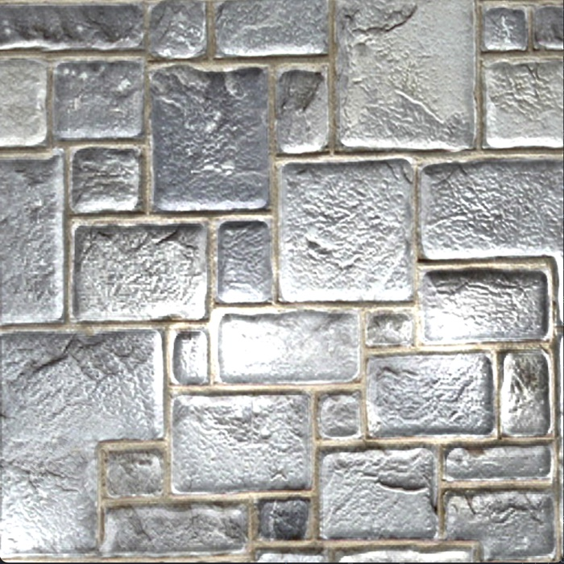

# OpenGL bump mapping example

Per-pixel bump mapping (normal mapping) in C++, OpenGL 2.1 and GLSL 1.10, written as a school-time pet project.
It draws a textured quad and lights it with three point lights. The lighting is computed in tangent space from a normal map.



## Requirements

- A C++11 compiler (clang or gcc)
- GNU make and pkg-config
- [SDL2](https://www.libsdl.org/): window, OpenGL context, BMP loading
- [GLEW](https://glew.sourceforge.net/): OpenGL 2.0 entry points
- A GPU/driver with OpenGL 2.0 or newer (compatibility profile)

### macOS (Homebrew)

```sh
brew install sdl2 glew pkg-config
```

### Debian / Ubuntu

```sh
sudo apt install build-essential pkg-config libsdl2-dev libglew-dev libgl-dev
```

### Fedora

```sh
sudo dnf install gcc-c++ make pkgconf SDL2-devel glew-devel mesa-libGL-devel
```

### Windows (MSYS2, MINGW64 shell)

```sh
pacman -S make mingw-w64-x86_64-gcc mingw-w64-x86_64-pkgconf mingw-w64-x86_64-SDL2 mingw-w64-x86_64-glew
```

## Build and run

```sh
git clone https://github.com/edgarMeinart/opengl-bump-mapping-example.git
cd opengl-bump-mapping-example
make run
```

| Command        | What it does                         |
| -------------- | ------------------------------------ |
| `make`         | Builds `build/bump` with `-O2`       |
| `make DEBUG=1` | Builds with `-O0 -g`                 |
| `make run`     | Builds, then starts the demo         |
| `make clean`   | Removes `build/`                     |

The binary finds its shaders and textures relative to its own location (`build/../assets/`), so it can be started from any directory: `./build/bump`.

Press `Esc` or close the window to quit.

On Linux under Wayland, distro GLEW is usually built for GLX. If `glewInit` fails, run through XWayland: `SDL_VIDEODRIVER=x11 ./build/bump`.

## Project layout

```
.
├── Makefile
├── assets/
│   ├── shaders/
│   │   ├── bump.vert        tangent-space light/view vectors
│   │   └── bump.frag        normal-mapped Phong lighting with attenuation
│   └── textures/
│       ├── stone_wall.bmp          base (color) map
│       └── stone_wall_normal.bmp   tangent-space normal map
├── docs/
│   └── screenshot.jpg
└── src/
    ├── main.cpp             entry point
    ├── app.{h,cpp}          window, GL setup, main loop, scene rendering
    ├── shader.{h,cpp}       GLSL program loading
    └── texture.{h,cpp}      BMP → OpenGL texture
```

## How it works

1. **Setup** (`App::init`): creates a 700×700 SDL2 window with an OpenGL context and initialises GLEW. It then builds the shader program and uploads the color and normal textures. The projection is orthographic, a 10×10 view.
2. **Geometry** (`App::drawLitQuad`): one quad in immediate mode. Every vertex has a normal `(0, 0, 1)` plus two generic attributes, `rm_Tangent = (1, 0, 0)` and `rm_Binormal = (0, 1, 0)`. Together these three vectors define the tangent space.
3. **Vertex shader** (`bump.vert`): transforms the tangent, binormal and normal with `gl_NormalMatrix`. It uses that basis to project the light and view direction vectors into tangent space.
4. **Fragment shader** (`bump.frag`):
   - reads the surface normal from the normal map: `N = rgb * 2 - 1`
   - computes ambient + diffuse `N·L` + specular `(R·V)^p`
   - applies distance attenuation `1 / (0.1·d² + 0.2·d + 1)`
5. **Multipass lighting** (`App::render`): the quad is drawn once per light. The first pass is opaque; the next ones are added on top with `glBlendFunc(GL_ONE, GL_ONE)`. Each pass also adds the ambient term, which is why the scene is fairly bright.

## History

Originally written as a Visual Studio 2008 project on Windows, using SDL 1.2 and `glaux`. In 2026 it was ported to SDL2 + GLEW, given a portable Makefile, and cleaned up into this layout. The old project files, build output and unused helpers are in the git history.

## Credits

The shader structure (`rm_Tangent` / `rm_Binormal`, `fvAmbient`, `fSpecularPower`, …) follows the AMD RenderMonkey bump mapping example.
