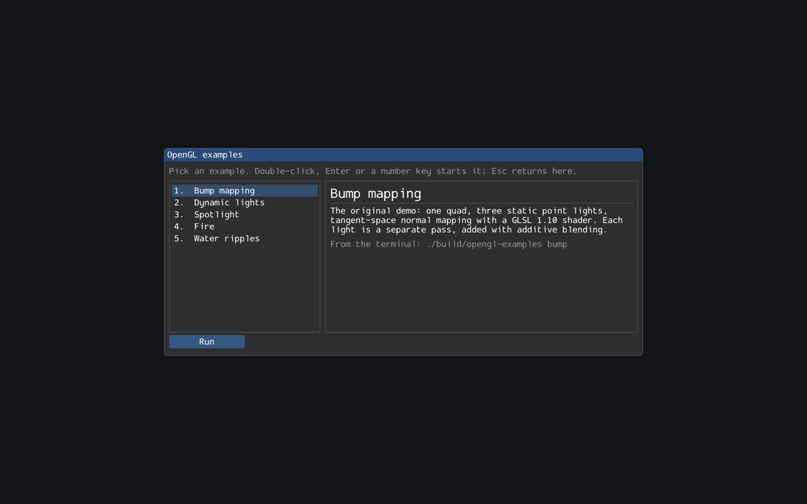
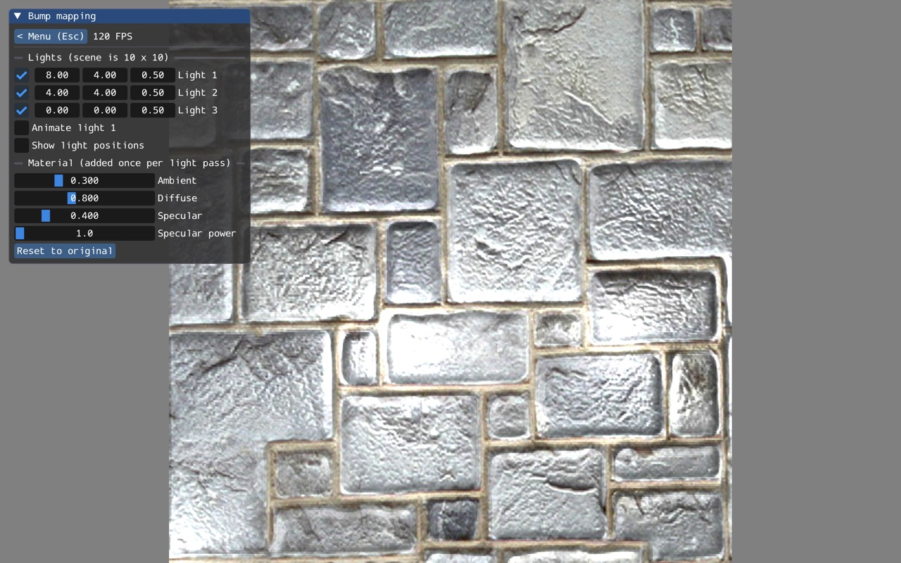
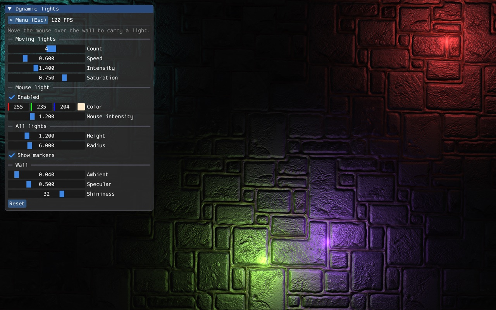
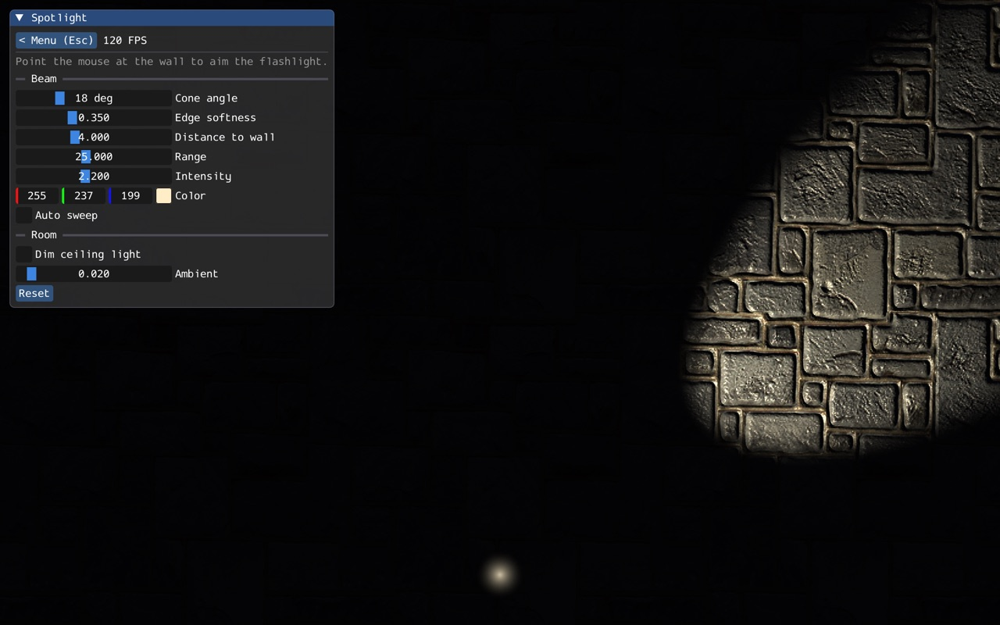
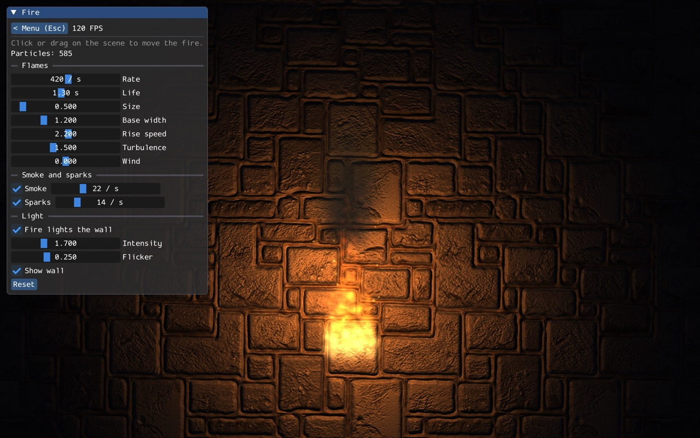
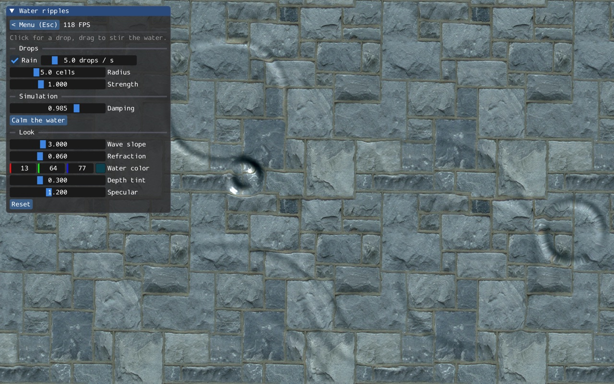

# OpenGL examples

A set of small real-time graphics demos in C++, OpenGL 2.1 and GLSL 1.10, with a [Dear ImGui](https://github.com/ocornut/imgui) start menu and live controls for every example.
It started as a school-time bump mapping project; that original demo is still the first example.



| Example | What it shows |
| ------- | ------------- |
| **Bump mapping** | The original project: tangent-space normal mapping, three point lights, one additive pass per light |
| **Dynamic lights** | Up to 8 colored point lights in one shader pass (uniform arrays), plus a light that follows the mouse |
| **Spotlight** | A flashlight aimed at the cursor: cone falloff, and the beam stretching into an ellipse at grazing angles |
| **Fire** | CPU particle system (flames, smoke, sparks) with additive and alpha blending, and a flickering light on the wall |
| **Water ripples** | Height-field wave simulation; the surface slopes refract the floor and add highlights. Click or drag to make waves |

## Requirements

- A C++17 compiler (clang or gcc)
- GNU make and pkg-config
- [SDL2](https://www.libsdl.org/): window, input, OpenGL context, BMP loading
- [GLEW](https://glew.sourceforge.net/): OpenGL 2.0 entry points
- A GPU/driver with OpenGL 2.0 or newer (compatibility profile)

Dear ImGui is vendored in `third_party/imgui`, so it needs no install.

### macOS (Homebrew)

```sh
brew install sdl2 glew pkg-config
```

### Debian / Ubuntu

```sh
sudo apt install build-essential pkg-config libsdl2-dev libglew-dev libgl-dev
```

### Fedora

```sh
sudo dnf install gcc-c++ make pkgconf SDL2-devel glew-devel mesa-libGL-devel
```

### Windows (MSYS2, MINGW64 shell)

```sh
pacman -S make mingw-w64-x86_64-gcc mingw-w64-x86_64-pkgconf mingw-w64-x86_64-SDL2 mingw-w64-x86_64-glew
```

## Build and run

```sh
git clone https://github.com/edgarMeinart/opengl-bump-mapping-example.git
cd opengl-bump-mapping-example
make run
```

| Command                 | What it does                                          |
| ----------------------- | ----------------------------------------------------- |
| `make`                  | Builds `build/opengl-examples` with `-O2`             |
| `make DEBUG=1`          | Builds with `-O0 -g`                                  |
| `make run`              | Builds, then opens the start menu                     |
| `make run EXAMPLE=fire` | Builds, then starts one example directly              |
| `make list`             | Lists the example names                               |
| `make compile_flags.txt`| Writes compiler flags for clangd and other editors    |
| `make clean`            | Removes `build/`                                      |

The binary can also be started directly, from any directory. It finds `assets/` next to `build/`.

```sh
./build/opengl-examples            # start menu
./build/opengl-examples water      # one example
./build/opengl-examples --list
./build/opengl-examples fire --screenshot fire.bmp   # save a frame after 3 s and exit (--delay to change)
```

### Controls

| Where       | Input                                            | Action                         |
| ----------- | ------------------------------------------------ | ------------------------------ |
| Start menu  | Click, double-click, `↑`/`↓` + `Enter`, `1`–`5`  | Pick and start an example      |
| Start menu  | `Esc`                                            | Quit                           |
| Any example | `Esc` or the **< Menu** button                   | Back to the start menu         |
| Any example | Settings window (top left)                       | Tweak the example live         |
| Dynamic lights | Move the mouse                                | Carry a light                  |
| Spotlight   | Move the mouse                                   | Aim the flashlight             |
| Fire        | Click or drag                                    | Move the fire                  |
| Water       | Click / drag                                     | Drop / stir                    |

On Linux under Wayland, distro GLEW is usually built for GLX. If `glewInit` fails, run through XWayland: `SDL_VIDEODRIVER=x11 ./build/opengl-examples`.

## The examples

### Bump mapping



The original demo, unchanged in look. A quad is drawn in immediate mode. Each vertex carries a normal and two generic attributes, `rm_Tangent` and `rm_Binormal`. The vertex shader (`bump_mapping.vert`) moves the light and view vectors into tangent space. The fragment shader (`bump_mapping.frag`) reads the normal map and computes Phong lighting with attenuation. The quad is drawn once per light: the first pass is opaque and the others are added with `glBlendFunc(GL_ONE, GL_ONE)`. Ambient is added in every pass, which is why the scene is bright. You can move the lights and change the material in the settings window.

### Dynamic lights



Colored point lights follow Lissajous curves over the wall. Every light is evaluated in **one pass**, using uniform arrays (`uLightPosition[8]`, `uLightColor[8]`, …) and a loop with a constant bound, which GLSL 1.10 requires. The wall lies in the z = 0 plane, so tangent space equals world space and no per-vertex tangents are needed. Attenuation is `(1 − d/radius)²`, which reaches exactly zero at the light radius. Shared code: `LitWall` in `src/examples/common.cpp` and `assets/shaders/lit_wall.*`.

### Spotlight



The same lighting shader with a spot cone: `smoothstep(cos(outer), cos(inner), dot(-L, spotDirection))`. The flashlight is held a few units in front of the wall at the bottom of the view. When it is aimed far to the side, the circular cone hits the wall at a grazing angle and stretches into an ellipse.

### Fire



A CPU particle system with three particle kinds:
- **Flames**: buoyant particles pulled toward the centre line (which makes the tongue shape) and pushed sideways by a cheap sine-based turbulence. Their color moves from white-yellow through orange to dark red with age, and they are drawn with additive blending (`GL_SRC_ALPHA, GL_ONE`), so overlaps brighten toward white.
- **Smoke**: slow, growing, darker sprites drawn first with normal alpha blending.
- **Sparks**: small, fast and heavier than the flames.

A point light at the fire flickers (a sum of out-of-phase sines plus noise) and lights the normal-mapped wall behind it. Every sprite uses one procedurally generated radial-falloff texture.

### Water ripples



A height-field simulation on the CPU, using the two-buffer wave equation: `next = (left + right + up + down) / 2 − previous`, multiplied by a damping factor. It runs at a fixed 60 steps per second. Each frame the surface slopes (central differences) are packed into an RGB texture. The fragment shader (`water.frag`) uses them to:
- shift the floor lookup (refraction)
- brighten slopes facing the light (cheap caustics)
- add a specular highlight and a Fresnel-like sky reflection on steep slopes

## Project layout

```
.
├── Makefile
├── assets/
│   ├── shaders/
│   │   ├── bump_mapping.{vert,frag}   original tangent-space bump mapping
│   │   ├── lit_wall.{vert,frag}       multi-light point/spot lighting of the stone wall
│   │   └── water.{vert,frag}          refraction, caustics and highlights from a slope texture
│   └── textures/
│       ├── stone_wall.bmp             color map
│       └── stone_wall_normal.bmp      normal map
├── docs/screenshots/
├── src/
│   ├── main.cpp                       command line
│   ├── app.{h,cpp}                    window, GL context, ImGui, start menu, example switching
│   ├── example.h                      Example interface and FrameInput
│   ├── assets.{h,cpp}                 asset path lookup
│   ├── gl/                            Shader and Texture wrappers (RAII)
│   └── examples/
│       ├── registry.cpp               list of examples shown in the menu
│       ├── common.{h,cpp}             World2D, sprites, glow texture, LitWall
│       ├── bump_mapping.cpp
│       ├── dynamic_lights.cpp
│       ├── spotlight.cpp
│       ├── fire.cpp
│       └── water.cpp
└── third_party/imgui/                 Dear ImGui 1.93.0 (core + SDL2 and OpenGL2 backends)
```

### Adding an example

1. Create `src/examples/my_example.cpp` with a class that derives from `Example` (`init`, `update`, `render`, `drawUi`) and a factory function `std::unique_ptr<Example> createMyExample()`.
2. Declare the factory in `src/examples/registry.cpp` and add an entry with an id, a title and a description.
3. Put shaders in `assets/shaders/` and load them with `assetPath("shaders/...")`.

`make` picks up new `.cpp` files automatically. Before `render` the app resets the GL state: identity matrices, no shader bound, no blending or depth test.

## Notes

- `stone_wall_normal.bmp` stores green pointing down the image (DirectX convention). `lit_wall.frag` flips y. The original bump-mapping quad maps the texture upside down, which cancels the flip there.
- The ImGui OpenGL2 backend cannot unbind shaders itself, so the app calls `glUseProgram(0)` before drawing the UI.

## History

Originally written as a Visual Studio 2008 project on Windows, using SDL 1.2 and `glaux`. In 2026 it was ported to SDL2 + GLEW, cleaned up into a standard layout, and extended with the start menu and the other examples. The old project files are in the git history.

## Credits

- [Dear ImGui](https://github.com/ocornut/imgui) by Omar Cornut and contributors, MIT License (`third_party/imgui/LICENSE.txt`).
- The original bump-mapping shader structure (`rm_Tangent` / `rm_Binormal`, `fvAmbient`, …) follows the AMD RenderMonkey bump mapping example.
